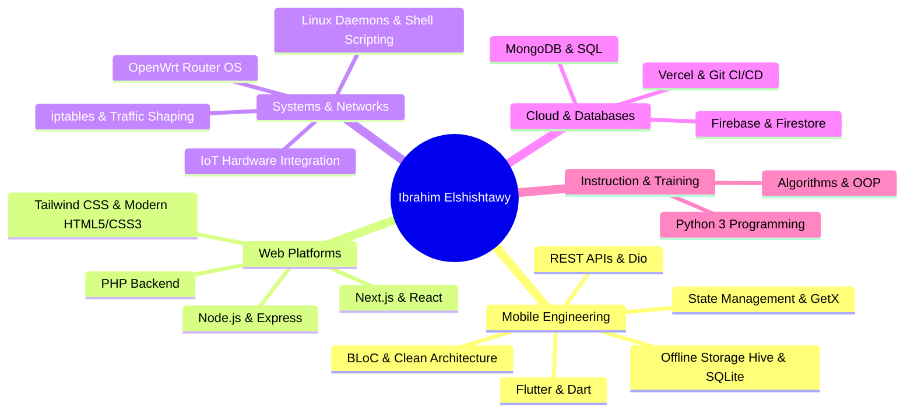

# 🚀 Ibrahim Elshishtawy | Portfolio & Systems Engineering

> **Full-Stack Mobile & Systems Architect**  
> مهندس برمجيات متخصص في تطوير تطبيقات الموبايل المتقدمة (`Flutter`)، منصات الويب والمؤسسات (`Next.js` & `PHP`)، هندسة الشبكات والعتاد (`OpenWrt` & `IoT Hardware`)، وتدريب البايثون (`Python`).

---

## 📌 نبذة تعريفية (About Me)

مهندس ومطور برمجيات ذو خبرة متعددة التخصصات، أجمع بين:
1. **تطوير تطبيقات الموبايل عالية الأداء**: بناء تطبيقات بمستوى إنتاجي رفيع باستخدام **Flutter & Dart** بالاعتماد على **Clean Architecture** و **BLoC** و **Micro-frontends**.
2. **منصات الويب والمؤسسات المتقدمة**: بناء بوابات ويب ضخمة وقابلة للتوسع باستخدام **Next.js** و **PHP Enterprise Backends** لصالح شركات رائدة مثل **Cyber-Wise**.
3. **هندسة الأنظمة والشبكات والعتاد (Systems & IoT)**: تطوير ديمونات لينكس (Linux Daemons) والتحكم في راوترات **OpenWrt** وإدارة كوتا الإنترنت وحزم البيانات وشبكات التوجيه مع ربطها بتطبيقات موبايل وعتاد هاردوير ذكي.
4. **التدريب والتعليم التقني**: مدرب بايثون معتمد، قمت بتدريب كوادر تقنية ضمن **كورس بايثون مستقبل وطن** وبناء منصات تعليمية تفاعلية لمبادرة **اتحاد بشبابها**.

---

## 🌟 المشاريع الرائدة في الموقع (Flagship Projects Showcase)

### 1. منصة الجونة لايف ستايل | Gouna Lifestyle Platform
* **الجهة / الشركة**: تم تنفيذ المشروع لصالح شركة **Cyber-Wise**.
* **التقنيات المستخدمة**: `Next.js` • `PHP Backend` • `Tailwind CSS` • `REST APIs` • `SSR / ISR Caching`.
* **رابط المنصة المباشر**: [Gouna Lifestyle Platform (Live)](https://gouna-lifestyle-platform-cbmy-3qqy66fpn-covantage-sr.vercel.app/ar)
* **تفاصيل العمل المنجز**:
  - بناء وتصميم واجهة مستخدم سياحية وترفيهية متطورة وفائقة السرعة لدعم استكشاف مدينة الجونة ومرافقها.
  - دعم كامل لتعدد اللغات (عربي / إنجليزي) وتوافق تام مع محركات البحث (SEO).
  - ربط الواجهة الأمامية المصممة بـ **Next.js** مع باك إند قوي وسريع مبني بـ **PHP** لمعالجة بيانات الفنادق، الفعاليات، وحجوزات الأنشطة بكفاءة عالية.

---

### 2. نظام إدارة شبكات وكوتا الراوتر | OpenWrt WiFi Quota & Bandwidth Manager
* **طبيعة المشروع**: مشروع هندسة أنظمة متكامل (Full-Stack Systems & IoT Hardware).
* **التقنيات المستخدمة**: `OpenWrt OS` • `Linux iptables/TC` • `Node.js Daemon` • `Flutter Mobile` • `Hardware IoT`.
* **مستودع الكود (GitHub)**: [openwrt-wifi-quota-manager](https://github.com/IbrahimElshishtawy/openwrt-wifi-quota-manager)
* **تفاصيل العمل المنجز**:
  - **سوفت وير الراوتر والشبكات**: التعديل على نظام تشغيل **OpenWrt**، وبرمجة قواعد جدران الحماية (`iptables`) وحزم التحكم في سرعة النطاق الترددي (`Traffic Control`).
  - **باك إند الراوتر**: بناء **Daemon** داخلي خفيف بلغة **Node.js** يعمل مباشرة على الراوتر لمراقبة استهلاك الميجابايت لكل جهاز متصل وتحديث السجلات في الوقت الفعلي عبر WebSockets.
  - **تطبيق فلاتر (Flutter Mobile App)**: تطبيق جوال احترافي لأصحاب الشبكات لمتابعة الحصص (Quota)، حظر وتحديد سرعات الأجهزة، وإعادة الشحن بضغطة زر.
  - **هاردوير (Hardware IoT)**: دمج بوردات العتاد ودوائر التحكم بمنافذ الراوتر الفيزيائية.

---

### 3. منصة اتحاد بشبابها & كورس بايثون مستقبل وطن | Etihad Bshababha & Python Academy
* **الجهة والمبادرة**: مبادرة **اتحاد بشبابها** و**كورس بايثون التابع لحزب مستقبل وطن**.
* **التقنيات المستخدمة**: `Next.js` • `Firebase` • `Node.js` • `Python 3` • `Data Structures`.
* **رابط المنصة المباشر**: [Etihad Bshababha Platform (Live)](https://etihad-bshababha.web.app/)
* **مستودع كورس بايثون (GitHub)**: [project_pyrthon](https://github.com/IbrahimElshishtawy/project_pyrthon)
* **تفاصيل العمل المنجز**:
  - تأسيس منصة تدريب وبوابة تواصل تفاعلية تدعم رفع الشروحات وتوزيع المهام البرمجية للطلاب.
  - إعداد وتدريس منهج بايثون شامل يغطي أساسيات البرمجة، هياكل البيانات (Data Structures)، الخوارزميات، والبرمجة الكائنية (OOP).
  - ربط المنصة بقواعد بيانات **Firebase** اللحظية وواجهات برمجة خلفية لتتبع درجات وتقييمات المتدربين.

---

### 4. منصة تجهيز المكاتب الذكية للمطورين | Pro Setup Platform
* **طبيعة المشروع**: منصة تفاعلية لتصميم واختيار مكاتب وأدوات بيئة العمل للمطورين وصناع المحتوى.
* **التقنيات المستخدمة**: `Modern JavaScript` • `Dynamic Layouts` • `Firebase Hosting` • `Custom CSS Glassmorphism`.
* **رابط المنصة المباشر**: [Pro Setup Platform (Live)](https://pro-setup-platform.web.app/)
* **تفاصيل العمل المنجز**:
  - بناء محاكي تفاعلي يتيح للمطورين تخصيص مكتب العمل (شاشات، كيبوردات ميكانيكية، إضاءة، أدوات مكتبية).
  - حساب الميزانية التقديرية وتوفير روابط شراء وكتالوج عتاد احترافي.

---

### 5. أبرز مشاريع الموبايل (Featured Flutter Mobile Apps)

| المشروع | التقنيات | الوصف الهندسي |
| :--- | :--- | :--- |
| **عقار (Aqar Real Estate)** | `Flutter`, `Clean Architecture`, `BLoC`, `Google Maps API` | منصة وتطبيق عقاري متكامل لإدارة العقارات مع خريطة جغرافية تفاعلية وفلاتر بحث متقدمة. |
| **بستان (Bostan Platform)** | `Flutter`, `Provider`, `REST APIs`, `Stripe Payments` | تطبيق تجارة إلكترونية زراعي متكامل يشمل إدارة سلة المشتريات والدفع الإلكتروني وتتبع الشحن. |
| **Animal Connect** | `Flutter`, `Firebase Auth & Firestore`, `Cloud Storage` | شبكة اجتماعية متخصصة في تبني الحيوانات الأليفة، التواصل بين المربين، وحجز الخدمات البيطرية. |
| **طِلاب (Tola'b Education)** | `Flutter`, `Video Streaming`, `PDF Viewer`, `Local Caching` | منصة تعليمية لطلاب الجامعات والمدارس لإدارة المقررات الدراسية ومتابعة المحاضرات والواجبات. |
| **EduAssess Pro** | `Flutter Desktop & Mobile`, `Hive DB`, `Sync Engine` | نظام امتحانات وتقييم أكاديمي إلكتروني يعمل بدون إنترنت (Offline-First) مع مزامنة سحابية. |
| **QuickBit Wallet** | `Flutter`, `Biometric Auth`, `Web3 / Crypto APIs` | محفظة رقمية للمدفوعات السريعة وتتبع الأصول الرقمية بأعلى معايير التشفير والأمان. |

---

## 🛠️ ترسانة المهارات والتقنيات (Tech Arsenal)

---

## 🎨 معمارية الموقع والتجربة السينمائية (Portfolio Website Architecture)

تم بناء الموقع بأسلوب سينمائي مبتكر ومخصص بالكامل بدون الاعتماد على قوالب جاهزة:
1. **Three.js WebGL 3D Engines**:
   - بوابة كونية ثلاثية الأبعاد تفاعلية في شاشة البداية (`intro-3d-canvas`).
   - خلفيات هولوجرافية ديناميكية تدعم التفاعل مع حركة الماوس.
2. **شاشات التيرمينال الهولوجرافية (Intro 3D Terminals)**:
   - 4 تيرمينالات برمجية تعرض أكواد حقيقية تمثل التخصصات:
     - موبايل: `mobile_app.dart`
     - باك إند: `server.api.ts`
     - شبكات وهاردوير راوتر: `openwrt_quota.sh`
     - ويب مؤسسي: `gouna_lifestyle.tsx`
3. **نظام الفلترة السينمائي (Cinematic Director Filter)**:
   - تبويبات فلترة سلسة تعتمد على مكتبة **GSAP** للانتقال الانسيابي بين تصنيفات المشاريع.
4. **محاكيات النوافذ المتقدمة (Interactive Mockups)**:
   - **Cyber Browser Mockup**: محاكي متصفح زجاجي تفاعلي يعرض واجهات الويب الحية مع شريط تحكم وإشارات المرور.
   - **Hardware Terminal Mockup**: محاكي شاشات تحكم شبكية وعتاد راوتر يعرض التردد وسرعة نقل البيانات ونبض الشبكة.

---

## 📬 تواصل معي (Get in Touch)

أنا متاح دائمًا للفرص الوظيفية المتميزة، المشاريع الاستشارية، وبناء الأنظمة المعقدة:

* **البريد الإلكتروني**: [elshishtawy.dev@gmail.com](mailto:elshishtawy.dev@gmail.com)
* **الهاتف / واتساب**: [+20 102 604 0827](https://wa.me/201026040827)
* **الموقع الشخصي**: [https://ibrahimelshishtawy.github.io](https://ibrahimelshishtawy.github.io)
* **حساب GitHub**: [@IbrahimElshishtawy](https://github.com/IbrahimElshishtawy)
* **حساب LinkedIn**: [Ibrahim Elshishtawy](https://linkedin.com/in/ibrahim-elshishtawy)

---
*صُنع وطُوِّر بشغف واحترافية بواسطة إبراهيم الششتاوي © 2026*
